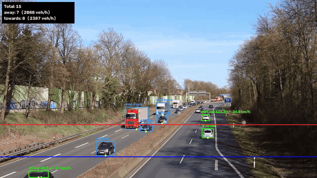

# vehicle-analytics

Count vehicles and measure their speed, with an error bar, from fixed-camera video.
Runs on your own machine; once the model weights have been downloaded it needs no network.



*Demo footage: "Motorway A40: on bridge above the traffic" by Kathinka Engels,
[CC BY 3.0](https://creativecommons.org/licenses/by/3.0), annotated by this software —
details in [docs/SAMPLE_VIDEO.md](docs/SAMPLE_VIDEO.md). This scene is not calibrated: its
speeds use an estimated distance and are for illustration only.*

## What it does

- Detects vehicles with YOLO and follows them with DeepSORT.
- Counts a vehicle, by direction and class, when its track crosses a line. A track is
  counted at most once.
- Measures speed between two lines, either from a known distance or from a ground-plane
  calibration, and reports a one-sigma uncertainty with every speed.
- Keeps one database row per vehicle: class, colour, lane, direction, times, speed and a
  snapshot.
- Flags rule violations from the tracks, keeps photo evidence, and drafts a challan PDF for
  each, for a person to review.
- Writes an annotated video, a CSV with one row per vehicle, and a JSON summary.

## How it works

```
frame → YOLO detections → DeepSORT tracks → bottom-centre point per vehicle
      → line crossings (sub-frame) → speed ± error → counts and flow → files
```

**Crossing.** A vehicle crosses a line when the signed distance from its reference point to
the line changes sign between two observations, however far apart they are. The crossing
point is where the straight path between them meets the line. The crossing instant assumes
constant speed between the two observations: on the ground plane when the scene is
calibrated, and in the image (`t = d_prev / (d_prev − d_cur)`) when it is not. In the image
that assumption is biased by perspective when the tracker has missed many frames.

**Reference point.** The bottom-centre of the box, where the vehicle meets the road. That is
the plane the calibration describes.

**Speed.** `distance / |t_b − t_a|` using the interpolated crossing times. Without a
calibration, `distance` is the configured distance between the lines. With one, both crossing
points are projected to the ground plane and the distance is measured there.

**Uncertainty.** Two independent relative terms, combined in quadrature:

| Term | Formula | Default |
|---|---|---|
| Box localisation, calibrated | `√(s_a² + s_b²) / distance` | `jitter_px = 2` |
| Box localisation, not calibrated | `√(p_a² + p_b²) / travel_px` | `jitter_px = 2` |
| Real-world scale | `distance_rel_uncertainty` | `0.05` |

A box-edge error of `jitter_px` across a line moves the crossing along the vehicle's path by
`p = jitter_px / cos θ` pixels, where θ is the angle between the path and the line's normal:
a vehicle that meets the line at a slant is timed less precisely. `p_a` and `p_b` are those
shifts at the two lines, and `s_a` and `s_b` are the same shifts in metres on the ground.
The two differ because a pixel covers more road far from the camera; on the motorway
footage below one pixel is about 0.8 m at the far line and 0.2 m at the near one. Without a
calibration the image scale is taken as uniform between the lines.

Both inputs are stated assumptions, set in the config. The error bar does not grow with the
number of frames the tracker missed around a crossing.

**Flow rate.** Vehicles per hour over the video time elapsed, `frame_index / fps`.

## Install

Python 3.10 or newer.

```bash
pip install -e .
```

YOLO weights download on first run.

## Use

```bash
vehicle-analytics run VIDEO --config configs/highway.yaml
vehicle-analytics run VIDEO --config configs/highway.yaml --out runs/my-run --no-display
```

Outputs go to `runs/<video name>/`:

| File | Content |
|---|---|
| `annotated.mp4` | Boxes, IDs, class, speed ± error, both lines, live counts |
| `events.csv` | One row per counted vehicle, with the same fields as the `vehicles` table below |
| `snapshots/` | The largest fully visible crop of each counted vehicle, in a folder per database run |
| `violations.csv` | One row per violation: rule, measured value, limit, margin, evidence files |
| `evidence/`, `challans/` | Evidence images and draft challan PDFs, in a folder per database run |
| `summary.json` | Counts, flow, speed mean / median / max by direction, config used |

## Records

Each run adds a row to `runs` and one row per counted vehicle to `vehicles` in a SQLite
file (`--db`, default `data/analytics.db`).

| Column | Meaning |
|---|---|
| `class`, `colour` | Majority detector class; a coarse colour name from the vehicle's largest views |
| `direction`, `lane` | Direction at the count line; the lane zone the vehicle was in when counted |
| `first_seen_s`, `last_seen_s`, `counted_at_s` | Seconds from the start of the video |
| `speed_kmph`, `speed_err_kmph`, `speed_mode` | Zone speed, its one-sigma error, and how the distance was obtained |
| `snapshot_path` | The largest fully visible crop of the vehicle |
| `plate` | Always empty: this software does not read number plates |

Lanes are polygons in the config (`zones`). Once a vehicle is fully in view the overlay shows
its live speed with a `~`, until its zone speed has been measured; the stored speed is the
zone speed. A box cut by the frame edge gives no live speed, because its reference point is
pinned to that edge.

```sql
-- Traffic and mean speed per lane
SELECT lane, direction, COUNT(*) AS vehicles, ROUND(AVG(speed_kmph), 1) AS mean_kmph
FROM vehicles WHERE run_id = 1 GROUP BY lane, direction ORDER BY lane;

-- The ten fastest vehicles, with their error bars
SELECT track_id, class, colour, lane, ROUND(speed_kmph, 1), ROUND(speed_err_kmph, 1)
FROM vehicles WHERE run_id = 1 ORDER BY speed_kmph DESC LIMIT 10;

-- Vehicles counted per ten seconds of video
SELECT CAST(counted_at_s / 10 AS INTEGER) * 10 AS from_s, COUNT(*) AS vehicles
FROM vehicles WHERE run_id = 1 GROUP BY from_s ORDER BY from_s;
```

On the 60-second validation clip the first query gives:

| Lane | Direction | Vehicles | Mean speed |
|---|---|---|---|
| `down_lane_1` (nearside) | down | 29 | 84.9 km/h |
| `down_lane_2` | down | 26 | 94.5 km/h |
| `down_lane_3` (offside) | down | 28 | 102.7 km/h |
| `up_lane_1` (nearside) | up | 21 | 34.2 km/h |
| `up_lane_2` | up | 28 | 35.9 km/h |
| `up_lane_3` (offside) | up | 26 | 40.2 km/h |

All 158 vehicles were given a lane on their own carriageway, and all have a snapshot. Lane
assignment has not been checked vehicle by vehicle; the rise in speed from the nearside to
the offside lane in both directions is what a motorway should show.

**Colour is the weak attribute.** The method first specified (median colour of the middle of
the crop) called 138 of the 158 vehicles blue, because the light in this footage has a blue
cast (the bare road is far from grey) and the middle of a vehicle seen head-on is
windscreen. The current method:

1. white-balances each crop against the road colour, taken as the median inside the lane
   zones over the last two seconds;
2. reads the brighter half of the pixels, which is paint rather than glass and tyres;
3. gives a hue name only to clearly saturated paint, and otherwise chooses black, grey or
   white by brightness relative to the road.

On the validation clip it names 67 vehicles grey, 46 black, 25 white, 11 red and 9 blue.
Checked by eye from contact sheets of the stored snapshots:

| Checked | Right | Misses |
|---|---|---|
| All 20 vehicles given a hue name | 18 | A white van named blue; an orange lorry named red |
| 24 of the 138 given a neutral name, picked at random | 18, and 3 arguable | Two black cars named grey; one blue car named black |

The thresholds were chosen on this one clip, in low evening light. Treat the column as a
hint, not a fact. A pale colour (light blue, beige) is reported as grey or white by design.

## Violations and challans

Rules are switched on in the config (`rules`). Each one reads the track of a vehicle and
fires at most once per vehicle. No learned model is involved after tracking.

| Rule | Fires when | Needs |
|---|---|---|
| `overspeed` | speed − 2 × its error bar is above the limit for the vehicle's class | a measured zone speed |
| `wrong_way` | the vehicle is counted in a lane whose permitted direction is the other one | lane zones |
| `restricted_zone` | it stays on a hard shoulder or in a restricted zone longer than `min_dwell_s` | such zones |
| `stopped` | its live speed stays below `stop_speed_kmph` in a lane longer than `min_stop_s` | a calibration and lane zones |
| `class_lane` | its class is listed in a lane's `banned_classes` and it stays there | lanes with that list |

A rule that the scene cannot support is switched off with a warning, and the run goes on.

**The error bar decides.** A vehicle measured at 110.7 ± 8.2 km/h on a road limited to
112.7 km/h is not flagged, and neither is one measured at 118 km/h: after two sigma, the
speed that can be stood behind is still under the limit. The measured value, the limit and
the margin are stored with the violation, so the decision can be re-derived from the row.

For each violation the frame at that moment (vehicle outlined in red) and the vehicle crop
are saved before any overlay is drawn, the row goes into `violations`, and a draft challan
PDF is written: [sample](docs/sample_challan.pdf).

```bash
vehicle-analytics run VIDEO --config configs/highway.yaml --fines configs/fines_india.yaml
vehicle-analytics challans --run 1 --fines configs/fines_india.yaml   # redraft later
```

A vehicle that breaks a rule without ever crossing the count line still gets a `vehicles`
row, with no direction; it is not in the counts or in `events.csv`.

What a challan is here, and is not:

- It is a **draft for a person to review**, status `pending_review`. Nothing is sent anywhere.
- It names a vehicle record and its photographs. **No registration number is read**, so it
  cannot name an owner.
- Colour is printed as "apparent colour (unverified)".
- The sections and penalties come from `configs/fines_india.yaml`, an example schedule read
  from the Motor Vehicles Act, 1988 (India Code text as on 21 May 2025); each entry gives
  its source. It covers `overspeed` (s. 183), `wrong_way` (s. 184, Explanation (e)) and
  `stopped` (s. 122 with s. 177). No section was found that clearly fits `restricted_zone`
  or `class_lane`; their challans print "As per applicable schedule" and no amount.
- The detector cannot tell a light motor vehicle from a heavy one, so where the penalty
  depends on that, both are printed and the challan says the legal class was not determined.
- Every page is marked "Demonstration - not a legal document".

The footage is British and the schedule Indian: the schedule is a configurable example of
how a jurisdiction's sections are attached, not a claim about where the video was taken.

### What the rules did on the validation clip

With the road's own limit, 70 mph = 112.7 km/h for every class (Highway Code Rule 124),
and the hard-shoulder and no-stopping rules (Rules 269 and 271):

| Rule | Fired | Notes |
|---|---|---|
| `overspeed` | 0 | Fastest vehicle 110.7 ± 8.2 km/h |
| `wrong_way` | 0 | All 158 vehicles were counted in a lane of their own carriageway |
| `restricted_zone` | 0 | No vehicle stayed on a hard shoulder for 2 s |
| `stopped` | 0 | The queuing carriageway moved at 31-46 km/h throughout |

Nothing was flagged. That is a check against false alarms on one minute of ordinary
traffic, not a measure of how many real violations the rules would catch: `wrong_way`, `restricted_zone` and `stopped` have never fired on real
footage and are covered only by tests on scripted tracks.

`class_lane` is not switched on for this scene. Highway Code Rule 265 bars vehicles over
7.5 tonnes from the right-hand lane, but the detector's `truck` covers light vans and heavy
lorries alike, and the rule would flag vans. For the same reason one speed limit is used
for every class, although goods vehicles over 7.5 tonnes are limited to 60 mph.

To exercise the challan path, the same clip was run with the limit lowered to 90 km/h
(`configs/highway_demo_limit.yaml`): 8 vehicles, measured at 105.7 to 110.7 km/h, were
flagged and 8 challans drafted. Those vehicles were not speeding; that file exists only to
demonstrate the path. The sample challan linked above comes from the freely licensed demo
clip instead, with an uncalibrated speed and a limit chosen for illustration.

## Configure

See [configs/highway.yaml](configs/highway.yaml). All image coordinates are fractions of the
frame, so a config does not depend on resolution.

| Key | Meaning |
|---|---|
| `lines.a`, `lines.b` | The two line segments |
| `count_line` | Which line counts a vehicle |
| `directions` | Labels for the two crossing directions |
| `speed.meters_between_lines` | Ground distance between the lines, when not calibrated |
| `calibration` | Four image points and their ground coordinates in metres |
| `zones` | Named polygons: lanes (with their allowed direction), hard shoulders, restricted areas |
| `site`, `recording_start` | Where and when the video was recorded, stored with the run |
| `rules` | Which violations to look for, with their limits and durations |
| `fps_override` | Frame rate, for files that do not report one |

## Calibrate

Pick a rectangle on the road whose real size you know, such as one lane wide and a known
number of lane markings long.

```bash
vehicle-analytics calibrate VIDEO --width-m 3.5 --length-m 12
```

Click its corners in this order: near-left, near-right, far-right, far-left. Paste the
printed block into the config. `--points "x,y x,y x,y x,y"` gives the corners without a window.

Use a rectangle that covers the part of the road you measure on. Four corners of one narrow
lane describe that lane well and the rest of the road badly: on the footage below, a single
3.70 m lane gave the right scale on its own carriageway but measured the opposite
carriageway 8 % short and 15 % narrow. The calibration in `configs/highway.yaml` is
therefore a least-squares fit of one ground plane to 21 lane marks across both
carriageways, with its four point pairs taken from that fitted plane. The comments in that
file give the method and the numbers.

## Results

Measured on a 60-second stretch (1501 frames) of UK motorway footage, 640×360 at 25 fps,
with `configs/highway.yaml`. The footage is third-party and is not included in this
repository.

| Direction | Traffic | Counted | With speed | Median speed | Range |
|---|---|---|---|---|---|
| down (towards camera) | free-flowing | 83 | 76 | 94 km/h | 77–111 km/h |
| up (away from camera) | queuing | 75 | 66 | 37 km/h | 31–46 km/h |

The error bar on each speed is ±7.4 %: ±5 % from the scale and ±5.5 % from box localisation,
most of it at the far line. Vehicles counted without a speed crossed only
one of the two lines under a single track ID, or were still between the lines when the clip
ended.

Counts against a manual count of the same clip:

| Direction | Manual count | System count | Difference |
|---|---|---|---|
| down (towards camera) | 83 | 83 | 0 |
| up (away from camera) | 74 | 75 | +1 |

The manual count was made once, by the author, on the annotated video at half speed, so it
was not blind to the system's boxes. It does not say whether the extra vehicle in the
queuing direction is a double count by the system or a miss by the person. One 60-second
clip in daylight shows that the counts are close here; it is not an accuracy figure.

Calibration, using lane-marking dimensions from UK design standards (lane line 2 m mark +
7 m gap; middle lane 3.70 m, outer lanes 3.65 m — sources in `configs/highway.yaml`):

| Check | Expected | Measured |
|---|---|---|
| Reprojection error of the 21 fitted marks | — | 1.0 px RMS, 1.9 px max |
| Length of the 36 m zone, per lane line (4 lines, used in the fit) | 36.0 m | 35.2–36.7 m |
| Lane line to edge line (4 sides, not used in the fit) | about 3.75 m | 3.62–3.93 m |

Only the edge-line row is independent of the fit. The lengthwise scale, which is what a
speed depends on, is supported by the consistency of the fit and not by a separate
measurement. The road was not surveyed: the dimensions are those of the current standard.
The measured mark positions and the fit are in `tools/fit_highway_calibration.py`, which
prints every figure in this table.

There is no ground truth for speed in this footage, so no speed accuracy is claimed. Each
speed carries the error bar described above.

## Limitations

- Fixed camera only.
- Occlusion and tracker ID switches: a vehicle whose ID changes between the two lines is
  still counted once, but has no speed.
- Speed accuracy depends on the calibration dimensions, which are taken from road standards,
  not surveyed.
- The detector is a general COCO model; vans are sometimes labelled as trucks.
- Colour is a coarse name, with thresholds chosen on one clip in low evening light at
  360 pixels high. It needs lane zones for its road reference: without them the colour of
  the light is not removed. A queue standing on the lanes for more than two seconds, or a
  wet or part-shadowed road, will shift the reference; neither has been tested.
- Lanes are strips of the fitted ground plane with standard widths, not surveyed lanes.
- No number plates are read, so a violation is tied to a vehicle record and its photographs,
  not to an owner.
- The detector's `truck` class covers light vans and heavy lorries alike; rules that depend
  on the legal class of a vehicle cannot be applied reliably.
- Three of the five rules have never fired on real footage.
- The sample challan uses an uncalibrated clip and a limit chosen for illustration.
- A database made by an earlier version of this software is refused; use a new file.
- Not real time: runs of the 1501-frame clip have taken between about three and eight
  minutes on the development laptop's GPU. The pipeline has not been profiled.

## Development

```bash
pip install -e ".[dev]"
pytest
ruff check .
```

The geometry, crossing, speed, state and statistics modules are pure Python and numpy. The
pipeline takes its detector and tracker as arguments, so its tests run on scripted tracks
with no model and no video.

## Roadmap

A local dashboard for browsing records and reviewing draft challans.

## Licence

AGPL-3.0-or-later, to match Ultralytics YOLO.
